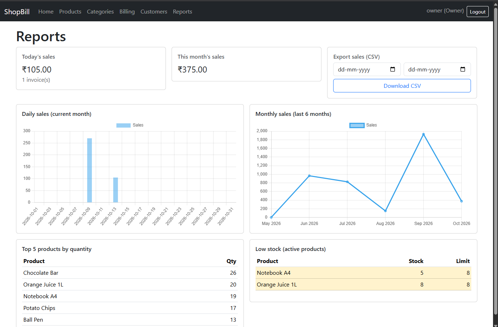
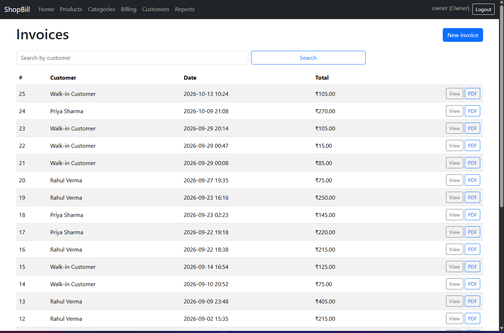
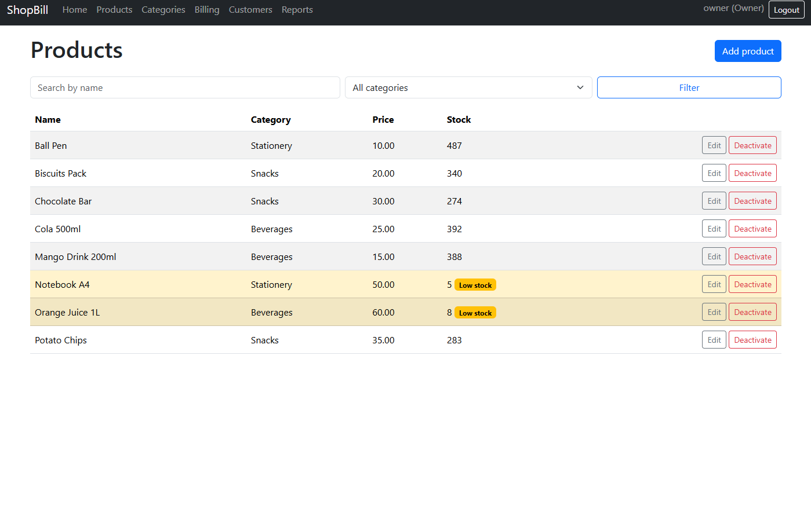

# ShopBill

Billing and inventory web app for a small retail shop.

## What it is

ShopBill lets a shop owner manage products and categories, bill customers at
the counter, download PDF invoices, and view sales reports. Two roles exist:
**Owner** (full access, including reports and admin) and **Staff** (billing
and viewing products only). Demo logins: `owner/demo123`, `staff/demo123`.

## Features

- Product/category CRUD with search, category filter, and low-stock
  highlighting; product deactivation is a soft delete (`is_active`).
- Customer management (both roles can create/edit).
- Invoice creation with a live JavaScript cart (product search, quantity,
  discount, tax, running total) and PDF download (ReportLab).
- Owner-only reports dashboard: today's/monthly sales, daily and 6-month
  charts (Chart.js), top 5 products, low-stock list, and CSV export with a
  date filter.
- Atomic invoice save: insufficient stock rejects the whole sale.

## Tech stack

Django, PostgreSQL in production (SQLite locally), Django templates with
Bootstrap 5, vanilla JavaScript, Chart.js (CDN), ReportLab, WhiteNoise +
Gunicorn for production, pytest-django for tests.

## Architecture note

Apps and models:

- `accounts`: custom `User` with an Owner/Staff `role` field,
  `OwnerRequiredMixin` / `RoleRequiredMixin`, login/logout, demo-user
  commands.
- `inventory`: `Category`, `Product` (price, stock, `low_stock_limit`,
  `is_active` soft delete), `StockMovement` (audit log of every stock
  change).
- `billing`: `Customer`, `Invoice` (customer, created_by, subtotal, tax,
  discount, total), `InvoiceItem` (product `PROTECT`, quantity, unit_price),
  plus `services.create_invoice()` and ReportLab PDF rendering.
- `reports`: Owner-only dashboard aggregates and sales CSV export.

## How the invoice save works

`billing/services.create_invoice()` runs inside `transaction.atomic()`: it
locks the product rows with `select_for_update()` (so two counters cannot
oversell), validates every line (active product, stock available), computes
totals server-side, creates the invoice and its items, reduces stock with
`F()` expressions (single queries that bypass `save()`), and writes one
`StockMovement` with reason `SALE` per item explicitly. If any line has
insufficient stock it raises `ValidationError` and the whole transaction
rolls back — no invoice, no items, no movements, no stock change.

## Local setup (Windows)

```powershell
python -m venv venv
.\venv\Scripts\Activate.ps1
pip install -r requirements.txt
copy .env.example .env
.\venv\Scripts\python.exe manage.py migrate
.\venv\Scripts\python.exe manage.py seed_demo_data
.\venv\Scripts\python.exe manage.py runserver
```

Open http://127.0.0.1:8000 and log in with `owner/demo123` or
`staff/demo123`. (`seed_demo_data` is idempotent; the demo owner is staff
but not a superuser.)

## Running tests

```powershell
.\venv\Scripts\python.exe -m pytest
.\venv\Scripts\python.exe manage.py check
```

## Deployment (Render + PostgreSQL)

1. Push this repo to GitHub. No secrets are committed (`.env` and
   `db.sqlite3` are gitignored).
2. Create a Render **PostgreSQL** database and a **Web Service** from the
   repo with build command `bash build.sh` (installs deps, runs
   `collectstatic` and `migrate`, then seeds demo data only when
   `SEED_DEMO_DATA=true`).
3. Set the Render start command to:
   `gunicorn config.wsgi:application --bind 0.0.0.0:$PORT`
4. Set these environment variables on the web service:

   | Variable | Example | Notes |
   |---|---|---|
   | `DJANGO_DEBUG` | `False` | Keep False in production (enables HTTPS-only). |
   | `DJANGO_SECRET_KEY` | _(generate a fresh one)_ | Required; never commit it. |
   | `DJANGO_ALLOWED_HOSTS` | `<app>.onrender.com` | Your Render domain. |
   | `CSRF_TRUSTED_ORIGINS` | `https://<app>.onrender.com` | Needed for login/forms over HTTPS. |
   | `DATABASE_URL` | _(Render provides this)_ | Set automatically when the database is linked. |
   | `SEED_DEMO_DATA` | `true` | Optional: seeds demo users/catalog/invoices during the build. |
   | `PYTHON_VERSION` | `3.13` | Pins the Python version Render builds with. |

With `DEBUG=False` the app forces HTTPS (behind Render's proxy header),
uses secure cookies, and enables HSTS.

Notes on Render's free tier: a free PostgreSQL database expires after
about 30 days (back up anything you need), and the first request after
the service idles takes about a minute while it spins back up.

With `DEBUG=False` the app forces HTTPS (behind Render's proxy header),
uses secure cookies, and enables HSTS.

## Screenshots / live link

Live demo: https://shopbill-nf41.onrender.com (login owner/demo123 or
staff/demo123; free hosting, so the first load after idle can take about a
minute).

## Screenshots


*Owner dashboard: today's and monthly sales, daily/monthly charts, top products.*


*Billing: invoice list with PDF download.*


*Products: search, category filter, and low-stock highlighting.*
